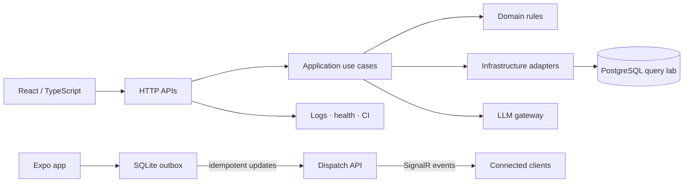

# Hi, I'm Robert Karuku 👋

### Senior Full-Stack & LLM Engineer · C#/.NET · React · TypeScript

I design and build dependable products across the whole stack: well-factored .NET services, accessible React interfaces, and practical AI integrations that solve real business problems. My work is grounded in clean boundaries, observable systems, and delivery practices that make software easier to change.

[](https://karuku.github.io/portfolio/)
[](https://github.com/karuku/portfolio/actions/workflows/ci.yml)
[](LICENSE)

## What I do

- Build APIs with C#, ASP.NET Core, Minimal APIs, Dapper, EF Core, SQL Server, PostgreSQL, Redis, and MongoDB.
- Ship responsive web and mobile experiences with React, React Native (Expo), TypeScript, Vite, Tailwind CSS, and Next.js.
- Apply Clean Architecture, DDD, CQRS, SOLID, event-driven workflows, and pragmatic testing.
- Integrate LLMs safely with versioned prompts, structured outputs, resilient clients, and human-review boundaries.
- Improve delivery with Docker, GitHub Actions, Azure DevOps, telemetry, and repeatable environments.

## Portfolio modules

This repository is an executable engineering portfolio—not a collection of screenshots. Each module is intentionally small enough to study and opinionated enough to discuss in an interview.

| Module | What it demonstrates |
| --- | --- |
| [`architectural-patterns`](architectural-patterns/) | A .NET 10 Clean Architecture reference API with CQRS-style handlers, validation, problem details, structured logging, and tests. |
| [`react-patterns`](react-patterns/) | Framework-agnostic TypeScript patterns for API clients, JWT refresh coordination, polling, and accessible async UI state. |
| [`03-mobile-react-native`](03-mobile-react-native/) | An Expo driver companion with SQLite-backed offline updates, connectivity awareness, an idempotent outbox, and tests. |
| [`ai-backend-bridge`](ai-backend-bridge/) | A provider-neutral .NET LLM gateway with versioned prompts, validated output, and an opt-in HTTP model adapter. |
| [`05-realtime-dispatch-systems`](05-realtime-dispatch-systems/) | A .NET dispatcher with deterministic nearest-driver matching, concurrency safety, idempotent updates, and SignalR events. |
| [`06-database-optimization`](06-database-optimization/) | A Dapper/Npgsql query lab demonstrating bounded keyset pagination and an index matched to the read path. |

## Engineering principles



- Dependencies point inward; domain code does not know about frameworks.
- External systems are adapters behind small interfaces.
- Invalid input is rejected at the boundary, while domain invariants remain enforceable everywhere.
- AI output is treated as untrusted data and validated before it reaches a business workflow.
- Every production path should be observable, testable, and boring to operate.

## Selected experience

I have 6+ years of experience delivering business software, including law-firm management and vehicle-hailing workflows. I enjoy the seams between product, architecture, and implementation: turning ambiguous requirements into systems that teams can confidently extend.

## Connect

- [GitHub](https://github.com/karuku)

Open to thoughtful conversations about full-stack engineering, platform work, and responsible LLM integrations.

## Local development

The repository is designed to be approachable without hidden setup. Start with the module README that matches what you want to explore. To run the full validation locally:

```powershell
dotnet test architectural-patterns/ArchitecturalPatterns.sln
dotnet test ai-backend-bridge/AiBackendBridge.sln
dotnet test 05-realtime-dispatch-systems/DispatchSystems.sln
dotnet test 06-database-optimization/DatabaseOptimization.sln
Push-Location 03-mobile-react-native
npm ci
npm run typecheck
npm test
Pop-Location
```

GitHub Actions runs all .NET tests and formatting checks, TypeScript compilation, mobile unit tests and native bundling, Docker Compose API/database smoke tests, link checks, and scheduled CodeQL analysis for C# and TypeScript.

To exercise the API in a container:

```powershell
docker compose up --build
Invoke-RestMethod http://localhost:5080/health
Invoke-RestMethod http://localhost:5090/health
Invoke-RestMethod http://localhost:5091/health
```

## Production notes

These are production-shaped reference implementations, not a deployed product. The dispatch and task APIs use in-memory state, the database lab is an isolated PostgreSQL sample, and the mobile app uses demo trip data. Before product use, add identity and authorization, durable assignment and idempotency stores, distributed SignalR scale-out, telemetry, secret management, backup/restore, and environment-specific deployment manifests.
