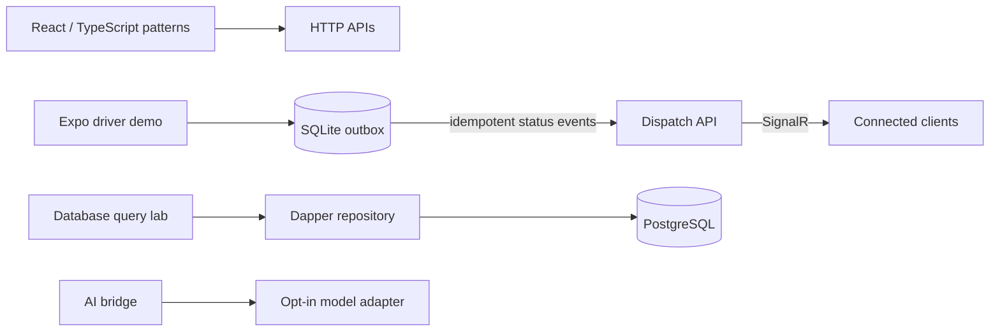

# Architecture decision record

## Why this repository is modular

The portfolio is structured as independently readable reference modules. The examples share concepts and contracts where useful, but they are not one deployed product or a claim that the demo services provide production identity, persistence, or scale-out.

## Runtime examples

## Boundary rules

1. The domain owns business language and invariants.
2. Application code orchestrates use cases through ports.
3. Infrastructure implements ports and may depend on external SDKs.
4. Presentation translates transport concerns into application requests and responses.
5. Tests at each boundary prefer deterministic fakes over network calls.

The dispatch matcher and pagination rules are tested without external services. Compose smoke tests exercise the HTTP contracts against the actual containerized APIs and PostgreSQL instance; SignalR negotiation is checked separately from domain tests.

These are deliberately lightweight rules: the goal is to create useful seams, not ceremony.
